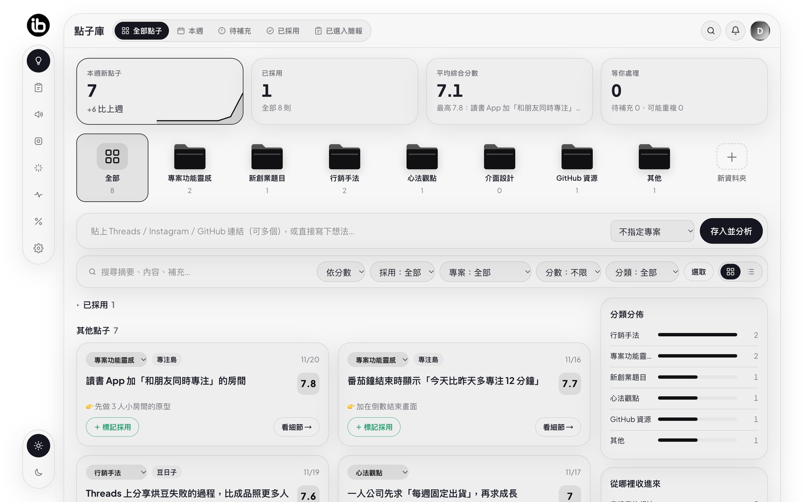
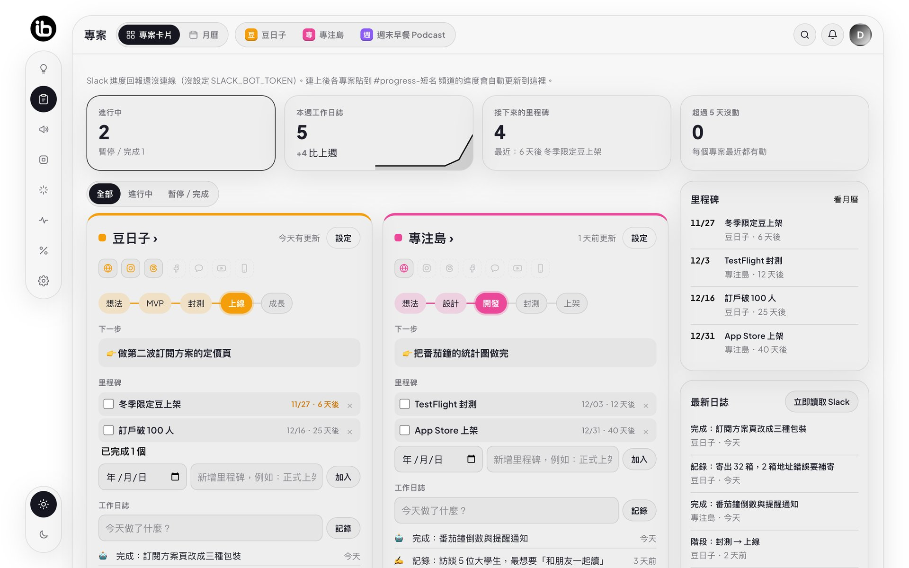
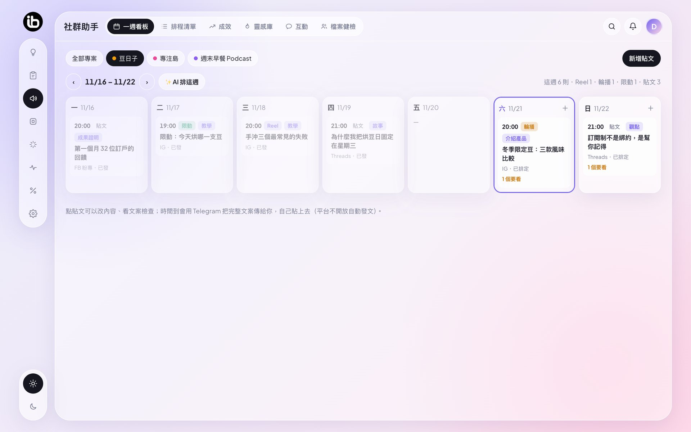
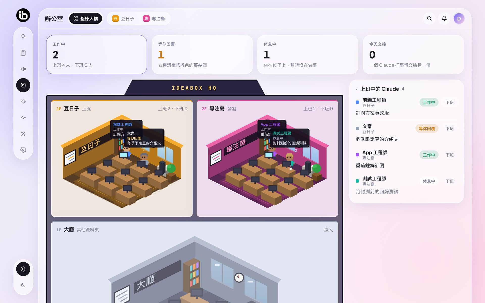
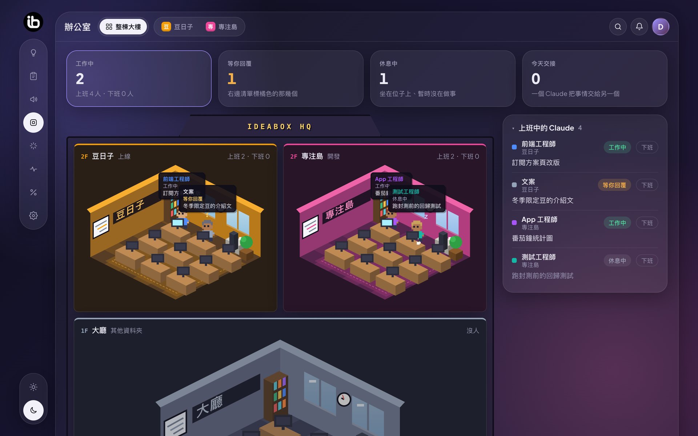

# ideabox — a founder's console

[繁體中文](README.md)

A personal dashboard for a solo founder. Send interesting posts to a Telegram bot and AI summarizes, categorizes, scores and files them. Your projects' stages, to-dos and schedule live in the same place, along with costs, grants, uptime of your products, and what the Claude Code sessions on your computer are doing.

Stack: Next.js 16 (App Router) + React 19 + Supabase + Vercel + Claude API + Telegram Bot, plus a read-only Expo mobile app.

> Built for **one person**: one login, one Telegram owner. Everyone deploys their own copy. A detailed user guide (Traditional Chinese) is in [docs/使用說明.md](docs/使用說明.md). The UI is bilingual (Traditional Chinese / English); some AI prompts (e.g. the grant radar) focus on Taiwan.




| Projects | Social assistant |
|---|---|
|  |  |
| **Office** (each Claude Code session is a pixel worker) | **Dark mode** |
|  |  |

<sub>Screenshots use demo data (the UI is shown in Traditional Chinese; English is available in settings).</sub>

---

## Features

| Page | What it does |
|---|---|
| Ideas `/` | Send links, screenshots or text via Telegram → AI summary, category and scores (value to your projects / feasibility / market), auto-filed into folders, likely duplicates flagged. Drag-and-drop folders; design ideas get design cards and a "design brief" |
| Projects `/projects` | Custom stages per project, next step, to-dos, work log; calendar (events) and timeline; active / paused / done |
| Project detail | Stage history, related ideas, product metrics, and **topic radar** (every Sunday, Apify searches Threads for your keywords; AI summarizes themes and pain points) |
| Social `/social` | Social posts per project: a week board and schedule (when it's time you get the copy on Telegram to post yourself; nothing is auto-posted); AI drafts for posts, Reel / carousel / story scripts, with live copy checks; "Plan with AI" builds a week from your work log, topic radar and ideas; a swipe file that ranks viral hooks by multiple of the account's usual views; results that show which posts actually work; drafts for comment replies, DMs and comments; a 100-point profile check |
| Office `/office` | Each running Claude Code session on your computer becomes a pixel character showing its role, status and current task (via Claude Code hooks) |
| Grants `/grants` | Every Sunday AI searches the web for startup grants and competitions; reminders 14 and 3 days before deadlines |
| Monitor `/monitor` | Add a URL and it's checked every 5 minutes; Telegram + push when it goes down or recovers; weekly system health check |
| Costs `/costs` | Subscriptions, one-off spend and AI usage (every Claude call is logged with its cost), total budget and runway |
| Settings `/settings` | About you, project descriptions (used by AI), appearance, weekly digest, learned preferences, mobile pairing |

Also:
- **Telegram bot**: save ideas, reply to add notes, change folder or project; `專案` for an overview, `myapp 下一步 …` / `myapp 待辦 12/1 …` / `myapp 排程 11/20-11/25 …` to update projects; `myapp 發文 11/21 20:00 IG Reel topic` to schedule a post with an AI draft
- **Slack progress sync** (optional): one channel per project; messages in the `【完成】【下一步】【階段】` format update the project
- Four themes (Mono by default, plus Fluento / Ember / Portal) × light / dark
- **Self-learning**: learns your preferences from what you adopt, delete and annotate
- **Mobile app** (`mobile/`): today, calendar, projects, ideas, office, push notifications

---

## 1. Deploy (about 30–40 minutes)

You need GitHub, Vercel, Supabase, Anthropic (Claude API) and Telegram accounts. All have free tiers (Claude API is pay-as-you-go).

1. **Fork** this repo.
2. **Supabase**: create a project → **SQL Editor** → open `supabase/schema.sql`, replace `https://YOUR-APP.vercel.app` in section 0 with your Vercel URL (or fix it later in Table Editor → `settings` → `app_url`) → run it all.
   Then **Authentication → Users → Add user** (your email + password, *Auto Confirm*), and turn off *Allow new users to sign up*. Note the Project URL, `anon` key and `service_role` key.
3. **Telegram**: talk to **@BotFather** → `/newbot` → copy the bot token.
4. **Claude API**: create an API key at console.anthropic.com (set a monthly limit).
5. **Vercel**: import your fork, fill in the environment variables from `.env.example` (`TELEGRAM_OWNER_ID` and `APP_URL` can be empty at first), deploy, then set `APP_URL` to your deployment URL and redeploy.
6. **Connect Telegram**: locally create `.env.local` with `TELEGRAM_BOT_TOKEN`, `TELEGRAM_WEBHOOK_SECRET`, `APP_URL`, then run `npm install && npm run setup:webhook`. Message your bot — it replies with your Telegram ID. Put it in `TELEGRAM_OWNER_ID` and redeploy.
7. Sign in at your URL, create a project, write a line in **Settings → About you**, and add your site under **Monitor**.

## 2. Optional features

| Feature | How |
|---|---|
| Topic radar | Set `APIFY_TOKEN`; add up to 5 keywords on a project page (capped at US$1 per run) |
| Slack sync | Create a Slack app with `channels:read channels:history channels:join groups:read groups:history`, set `SLACK_BOT_TOKEN` |
| Office | Set `CLAUDE_HOOK_SECRET`; copy `tools/claude-hook/ideabox-office.sh` to `~/.claude/hooks/`, put the secret in `~/.claude/ideabox-hook.secret` and your URL in `~/.claude/ideabox-hook.url`, register it for `SessionStart`, `UserPromptSubmit`, `PostToolUse`, `Notification`, `Stop`, `SessionEnd` with `"async": true`. Your prompts are never stored — secrets are masked and AI condenses them into a role + one-line task |
| GitHub info | Set `GITHUB_TOKEN` (read-only) |
| Mobile app | See `mobile/README.md` |

## 3. Add your own features (modules)

The core knows nothing about any specific product. Put your own things in modules instead of editing the core:

- `lib/modules/server.ts` — server modules: daily jobs, extra monitor checks and user metrics, health checks, bell counts, extra Telegram destinations (routing and "move to…" buttons are added automatically), per-project report counts.
- `lib/modules/meta.tsx` — extra pages, side-rail views, mobile tabs, labels.
- Types and docs: `lib/modules/types.ts`.

## 4. Development
```bash
npm install
cp .env.example .env.local
npm run dev        # http://localhost:3000
npm test           # vitest; all external APIs are faked
npx tsc --noEmit
```

## License
[MIT](LICENSE). AI output is for reference only.
