# ideabox 使用說明

這份說明介紹 ideabox 每個功能怎麼用。還沒部署的話，先照 [README](../README.md) 的「部署」做完。

> 說明裡的截圖都是示範資料（虛構的創業者與專案「豆日子」「專注島」），你部署後看到的是你自己的資料。

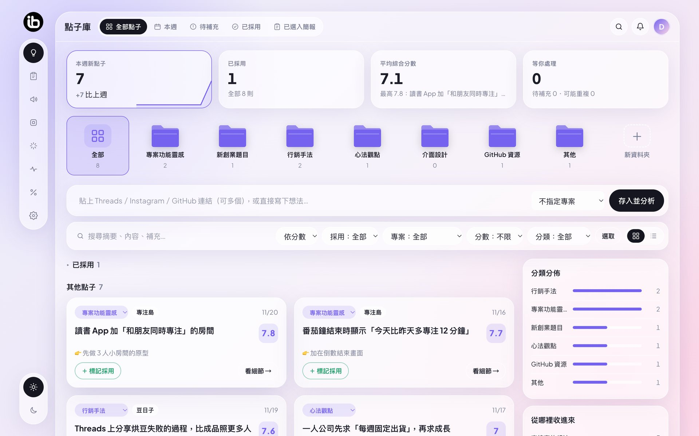

---

## 功能總覽

| 功能 | 一句話 | 在哪裡 |
|---|---|---|
| 點子庫 | Telegram 傳進來的連結、截圖、文字，AI 自動摘要、分類、評分、放進資料夾 | 網頁 `/`、Telegram |
| 資料夾 | 一層資料夾，AI 自動歸類，可拖曳、改名、換色 | 點子庫最上面 |
| 可能重複 | AI 比對之前的點子，同一個東西會標「可能重複」 | 點子卡片 |
| 設計收藏與設計簡報 | 介面設計、GitHub 專案另外用設計卡片顯示，可以挑幾則產生一份設計簡報 | 點子庫「已選入簡報」、`/design/brief` |
| 專案管理 | 每個專案自訂階段、下一步、里程碑、工作日誌 | `/projects` |
| 月曆與時程表 | 有日期的排程、里程碑，月曆或時程表兩種看法 | `/projects?view=calendar` |
| 專案詳細頁 | 階段歷程、這個專案的點子、產品數據、話題雷達 | `/projects/<短名>` |
| 話題雷達 | 每週日抓 Threads 上你設定的關鍵字討論，AI 整理成主題與痛點 | 專案詳細頁 |
| 社群助手 | 排社群貼文、AI 寫草稿與腳本、文案檢查、排一週內容、靈感庫、成效、互動、檔案健檢 | `/social` |
| 辦公室 | 電腦上每個執行中的 Claude Code 變成一個像素小人 | `/office` |
| 補助雷達 | 每週日 AI 上網找創業補助與競賽，截止前提醒 | `/grants` |
| 產品監控 | 加網址就每 5 分鐘檢查，掛掉／恢復通知你；每週系統健康檢查 | `/monitor` |
| 成本 | 訂閱、一次性開銷、AI 用量、總預算、還能撐幾個月 | `/costs` |
| 週報 | 每週日晚上傳本週精選點子、補助、花費到 Telegram | 自動 |
| AI 自我學習 | 從你採用、刪除、補充的點子學偏好 | `/settings?view=learn` |
| Slack 進度回報 | 讀 Slack 頻道的進度訊息，自動更新專案 | 選填 |
| 手機 App | 今天、月曆、專案、辦公室，加推送通知（唯讀） | `mobile/` |
| 雙語、主題 | 中文／English；Fluento／Ember／Portal／黑白 × 淺色／深色 | 右上角頭像選單、設定 |

---

## 一、點子庫

### 存點子（Telegram）
- **Threads／Instagram 貼文**：在貼文按「分享」→ Telegram → 傳給你的 Bot。幾秒後 Bot 回覆分析結果。
- **一次存很多則**：一則訊息貼好幾個連結（最多 10 個）。
- **加上你的想法**：連結旁邊打的字會當成「你的補充」，AI 分析時會參考。
- **截圖**：直接傳圖片；AI 會讀圖裡的文字。
- **純文字靈感**：直接打字傳給 Bot（至少 4 個字）。
- **讀不到內容時**：Bot 會提示，**回覆那則訊息**補一句重點，就會重新分析。
- **強制存點子庫**：開頭打「點子」，例如「點子 用排行榜提高留存」。

Bot 回覆下面有按鈕：
- **資料夾按鈕**：AI 選的會打勾，按別的就搬過去（可以再改）。
- **專案按鈕**：按了代表「這是某個專案的點子」，AI 會針對那個專案重新評分；再按一次取消。

### 存點子（網頁）
點子庫上方的輸入框貼連結或文字，按「存入並分析」。可以順便選專案。

### 看點子

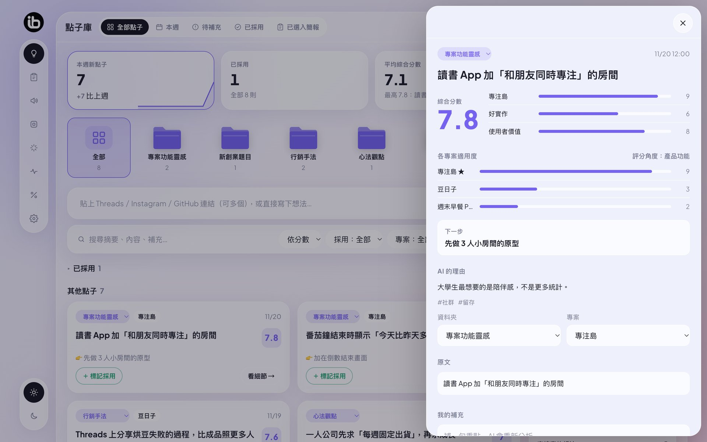
<sub>點一張卡片從右邊滑出詳情：三項分數、對每個專案的適用度、AI 的理由與下一步。</sub>
- 卡片顯示：分類、專案、標題、綜合分數、下一步。點卡片看詳細：AI 的理由、三項分數、標籤、原文。
- **三項分數**（各 1～10 分）：對專案的參考價值 40%、好不好實作 30%、市場或參考價值 30%，加權成綜合分數。
- **篩選**：採用狀態、專案、分數下限、分類（會記在網址上，可以存書籤）。
- **已採用**：卡片上按「標記採用」；已採用的排在最上面一區。
- **可能重複**：AI 覺得跟之前某則講同一件事時會標出來，可以「刪除這張」或按「不是重複」。
- **右鍵選單**（手機按 ⋯）：搬到資料夾、採用、加入簡報、刪除。

### 資料夾
- 點子庫最上面一排是資料夾，點進去只看那個資料夾。
- 把卡片拖到資料夾上就搬過去；也可以「選取」多張一起搬。
- 資料夾可以拖曳排序；右鍵可以改名、換顏色、刪除（裡面的點子會變「未分類」）。
- AI 分析時會從你的資料夾挑一個放；你手動搬過的點子，之後重新分析不會再被 AI 搬走。

### 設計收藏
介面設計的截圖、貼文、GitHub 專案會用設計卡片顯示（AI 會看圖分析風格與值得學的手法；GitHub 另外顯示星星數、語言、授權）。按「加入簡報」挑幾則，再到「已選入簡報」→ 產生設計簡報，可以複製或下載 Markdown 給設計工具或 AI 參考。

---

## 二、專案

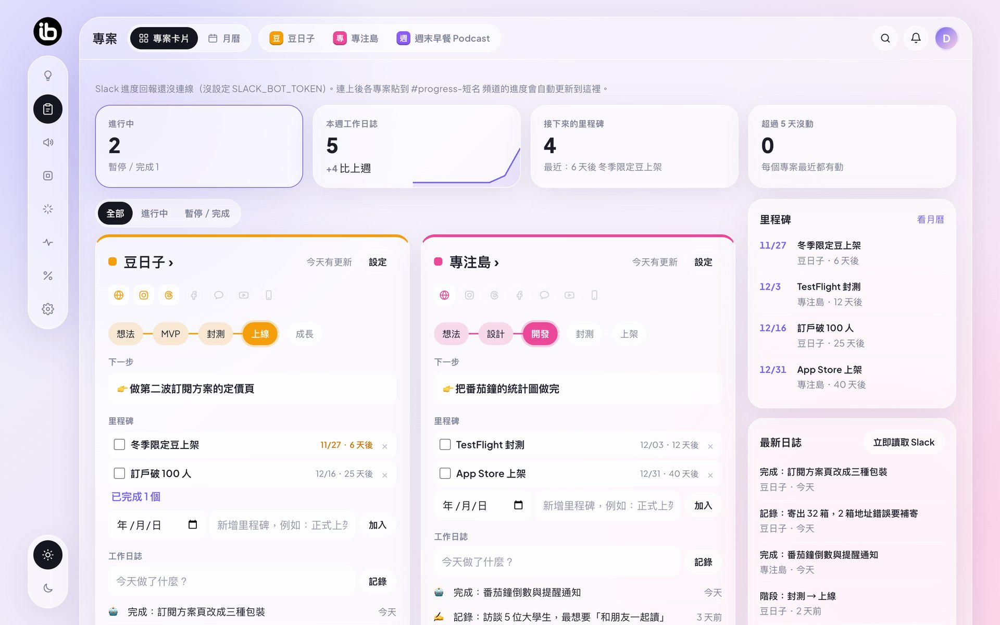
<sub>專案卡片：自訂階段、下一步、里程碑與工作日誌，右邊是全部專案接下來的里程碑。</sub>

### 建立與設定
1. 到「專案」按「新增專案」，填名稱與**短名**（英文小寫，Telegram 指令用，例如 `myapp`）。
2. 專案卡片的「設定」可以改：
   - **階段**：自己定，例如「構想 → 開發 → 封測 → 上架 → 成長」
   - **一句話描述**：AI 分析點子時用來判斷跟這個專案有沒有關係（寫越清楚越準）
   - **資料夾名稱**：辦公室畫面用（見下方「辦公室」）
   - **Slack 頻道**、**官網與社群連結**（卡片上會出現快捷圖示）
3. 狀態：進行中／暫停／完成。暫停和完成的專案不會提醒。

### 下一步、里程碑、日誌

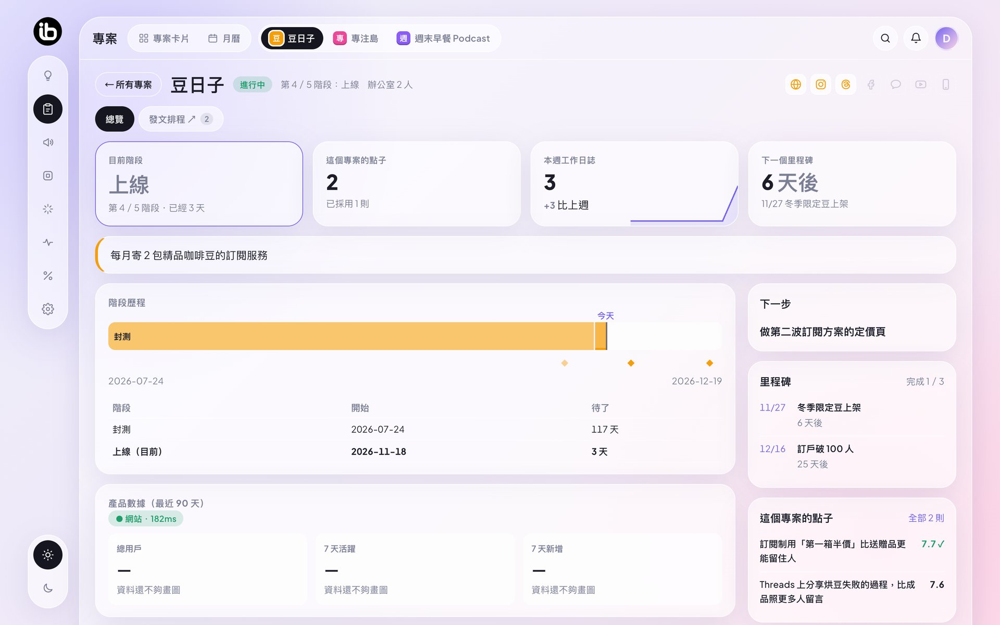
<sub>專案詳細頁：目前階段、階段歷程色條、里程碑、這個專案的點子、產品數據。</sub>
- 卡片上直接改「下一步」、切換到下一個階段、加里程碑（有日期，前 7 天、前 1 天提醒）。
- 每次變動都會記進工作日誌；詳細頁看得到完整歷程與「階段歷程」色條。

### 月曆與時程表

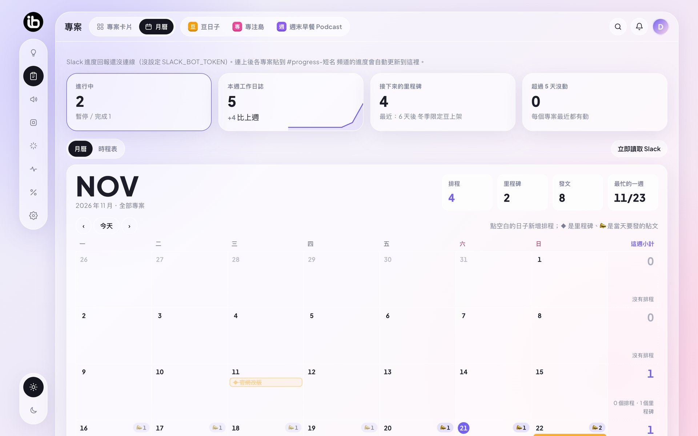
<sub>月曆：全部專案的排程、里程碑、發文排程放在一起。</sub>
- 左側列切到「月曆」：點某一天新增排程（可以選開始～結束日期、選填開始時間），點排程可以改或刪。
- 「時程表」：每個專案的階段色條、依里程碑推估的接下來階段、每天的活動量，可以看 3 個月／6 個月／1 年。
- 有填時間的排程，手機 App 會在開始前 30 分鐘推送。

### 用 Telegram 更新專案
| 傳這個 | 會怎樣 |
|---|---|
| `專案` | 回覆所有專案的總覽 |
| `myapp 下一步 做好友動態` | 改下一步 |
| `myapp 下一階段` | 前進到下一個階段 |
| `myapp 階段 上架審核` | 跳到指定階段 |
| `myapp 記錄 修好地圖` | 寫一筆工作日誌 |
| `myapp 里程碑 12/1 正式上架` | 新增里程碑 |
| `myapp 排程 11/20-11/25 封測第二輪` | 新增排程（多天） |
| `myapp 排程 12/1 14:00 開會` | 新增有時間的排程 |

（`myapp` 換成你的專案短名。）

### 每天早上 8 點
Telegram 收到專案總覽：今天的排程、快到的里程碑、超過 5 天沒動的專案（問你還在做嗎）。

### 話題雷達
1. 需要先設定 `APIFY_TOKEN`（見 README）。
2. 到專案詳細頁的「話題雷達」填最多 5 個關鍵字。
3. 每週日早上自動抓 Threads 最近 7 天的熱門貼文，AI 整理成：整體摘要、討論主題、使用者痛點（附原文連結）。高分、有原文的痛點會自動存成這個專案的點子。
4. 想馬上看可以按「現在抓一次」（每次費用上限 1 美元）。

---

## 三、社群助手

左側選單的「社群助手」。上面一排切換專案（或看全部專案），左側列有六個檢視。**它不會幫你發文、留言或傳訊息**：所有內容都是草稿，你自己複製去貼。平台不開放自動發到社團，自動留言和大量私訊也會讓帳號被限制。

### 一週看板與排程清單

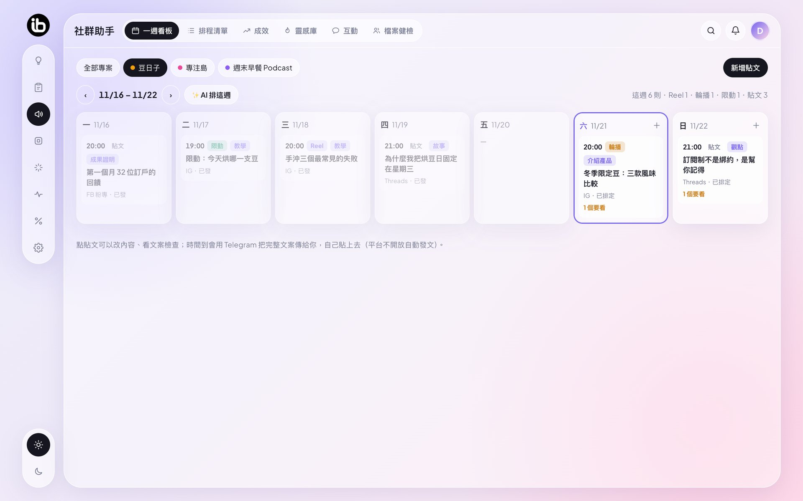
<sub>一週看板：每則貼文一張小卡，看得到時間、格式、平台、狀態和文案檢查結果。</sub>
- 看板是星期一到星期日七欄，每則貼文一張小卡。點卡片從右邊滑出編輯面板，每天右上角的「＋」在那天新增。
- 排程清單列出全部貼文，可以切「待發／已發／全部」。
- 狀態有草稿、已排定、已發、略過。**已排定**的時間到了，Telegram 會傳兩則訊息給你：第一則說發在哪裡，第二則只有文案（長按就能複製），下面有「已發／延後 1 天／略過」按鈕。草稿不會提醒。
- 也可以在 Telegram 傳「`myapp 發文 11/21 20:00 IG Reel 主題`」直接排一則（時間可省略，預設 20:00）。

### 格式與 AI 草稿
- 平台：FB 社團、FB 粉專、IG、Threads、Dcard、LINE 官方帳號。
- 格式：貼文、Reel 短影片、輪播、限時動態（IG 和 FB 粉專四種都有，其他平台只有貼文）。
- 填好主題按「AI 寫草稿」。Reel 會給三個開頭選項、口白、畫面字卡、分秒分鏡和貼文說明；輪播給逐張文案；限動給 3～5 格和要放的互動貼圖。
- 類型（成果證明／教學／觀點／故事／介紹產品）是選填，選了 AI 會照那個方向寫。
- AI 只用專案設定裡的一句話描述和連結，不會編數字或經歷。寫出來的請改成你自己的口氣再發。

### 文案檢查
編輯面板下面邊打邊檢查，不花 AI 費用，只提醒、不擋你存檔：
- 要改的：IG 文案裡放連結（不能點）、IG 超過 5 個 hashtag、超過字數上限。
- 提醒：AI 腔的用詞、破折號、打招呼開頭、第一段太長會被「…更多」切斷、表情符號太多、沒有行動呼籲、一次要讀者做太多件事。
- 從別處貼上時混進來的看不見字元，存檔時會自動清掉。

### AI 排這週
在一週看板選一個專案，按「AI 排這週」。可以補幾句這週發生的事，越具體排得越準。AI 會讀這個專案最近 14 天的工作日誌、話題雷達的痛點、高分點子、靈感庫、你貼文的成效和最近發過的主題，排出最多 5 則（只有主題、格式、類型、時間）。勾選要的存成草稿，文案之後點進去再寫。

工作日誌是你內部的紀錄，存之前請看一下每則主題適不適合公開講。

### 靈感庫
看到同領域爆紅的貼文，把開頭第一句、這則的觀看數、那個帳號平常的觀看數貼進來（可以寫「41萬」「18k」）。
- 程式會算「是他平常的幾倍」。3 倍以上才算他找到了什麼；觀看數很大但只有 1 倍，只是他平常的一天。
- 開頭會自動歸成十種公式（沒人告訴你、代價自白、反直覺、提問…），上面統計最常出現的。
- 有設定話題雷達的話，每次抓完讚數最高的 5 篇會自動存進來。
- AI 寫草稿時會參考這裡的開頭，只學句子的形狀，不抄內容。

### 成效

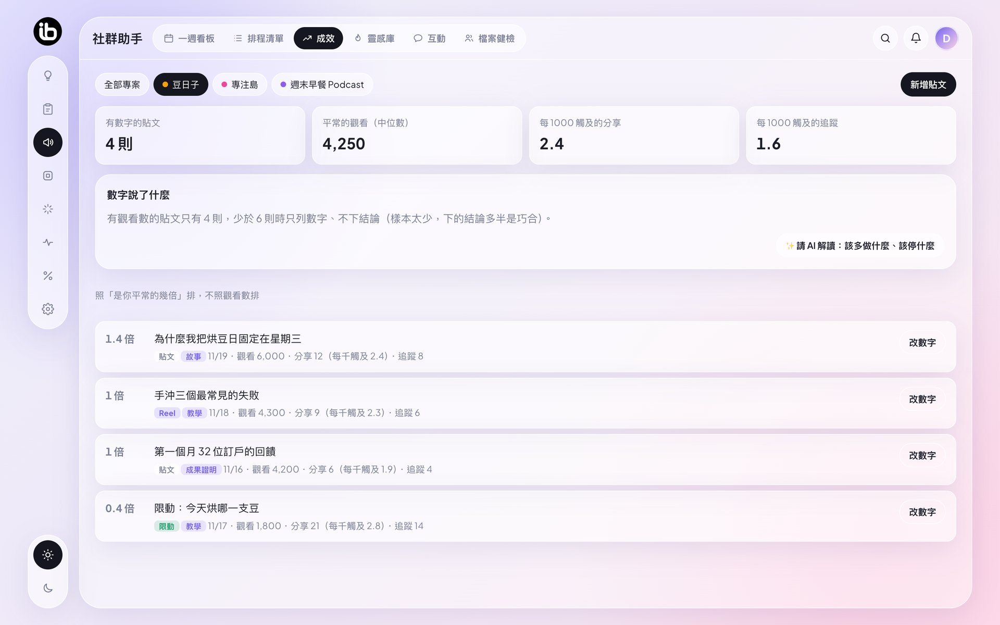
<sub>成效：照「是你平常的幾倍」排，而不是照觀看數排。</sub>
貼文標成「已發」後，點開它會多一塊「成效」，填觀看、觸及、分享、新追蹤等數字（到平台的洞察報告看），或貼洞察報告的截圖讓 AI 讀出來，核對後按「存數字」。平台不開放自動抓這些數字。
- 成效檢視照「是你自己平常的幾倍」排，不照觀看數排，另外算每 1000 次觸及帶來幾次分享與追蹤。
- 「數字說了什麼」是程式算的：有觀看數的貼文少於 6 則只列數字、不下結論；之後差距夠大才會說哪種格式或類型有效。
- 選一個專案可以按「請 AI 解讀」，會回該多做什麼、該停什麼、下一則試什麼。

### 互動
三個工具，都要先選一個專案：
- **回覆留言**：貼上你貼文下面的留言（一行一則），AI 分成六類並寫回覆。廣告、互追這類會標「不用回」。很多人都會想問的問題可以按「存成 Reel 草稿」。第二格寫貼文在講什麼、你請大家留哪個字、回覆可以用的事實，回覆才會準。
- **寫私訊**：回覆舉手的人、熟人的第一則、合作提案三種，附第 4 天和第 10 天兩則追蹤訊息。一定要寫「今天為什麼傳給他」，沒有理由的私訊就是打擾。
- **去別人貼文留言**：貼上對方的貼文，給兩種不同寫法的留言。不會推銷、不會放連結。

### 檔案健檢
貼一張個人檔案的截圖（頭像到前兩排貼文），或自己填名稱欄、簡介、連結、精選、置頂、前九則。AI 照 12 項打 100 分，照扣最多分的順序給可以直接照抄的改法。沒提供的項目會給 0 分並寫「沒辦法評」。每個專案會記住上一次的結果。

---

## 四、辦公室

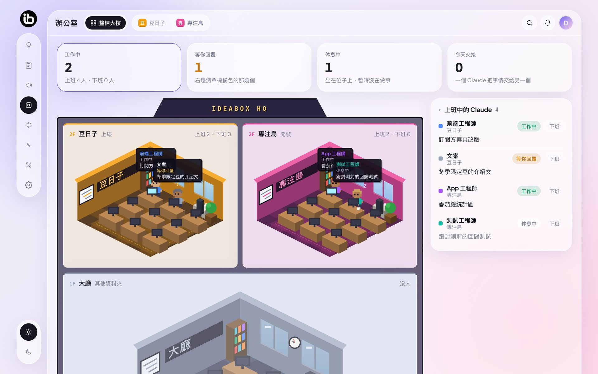
<sub>每個專案一間房間，小人頭上有職位與狀態，右邊清單列出上班中的 Claude。</sub>

把電腦上的 Claude Code 變成辦公室裡的小人：
- 每個專案一間房間，沒對到專案的在大廳。
- 小人頭上有職位（例如前端工程師），以及狀態：工作中、等你回覆（頭上冒「?」）、休息中（桌上有咖啡）。
- 同一個專案、同一個職位算同一個人；可以在清單上手動指定職位。
- 超過 30 分鐘沒動靜，或 Claude Code 結束，就算下班；7 天內上過班的會留在辦公室走動。

設定方式見 README「辦公室設定」。你打給 Claude 的原文不會存起來，只存 AI 濃縮的一句話。

---

## 五、補助雷達

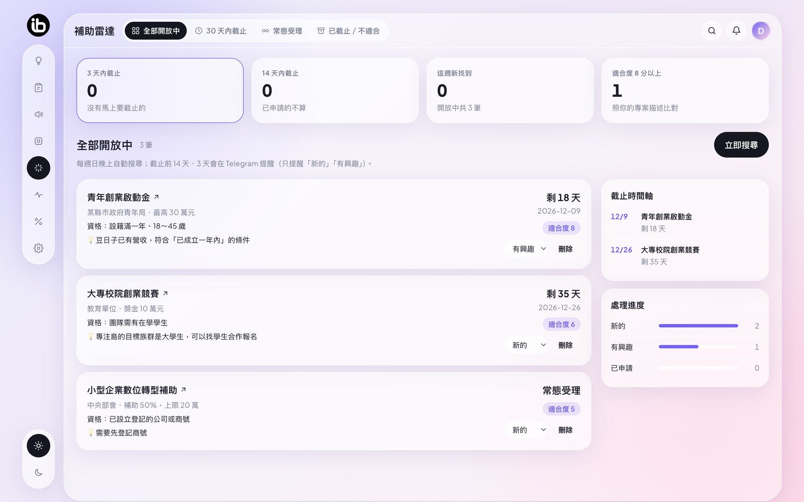
<sub>AI 找到的補助與競賽，附適合度、理由、截止日倒數。</sub>

- 每週日晚上 AI 上網搜尋開放中的創業補助、政府計畫、競賽、加速器，存進列表並評「適合度」。
- 到「設定 → 專案描述」寫好「關於你」（身分、所在地、階段），找到的會更準。
- 可以標記「有興趣」「已申請」「不適合」；有興趣的在截止前 14 天、3 天提醒。
- 想馬上找一次：補助雷達頁按「立即搜尋」。
- Telegram 傳 `/grants` 看 60 天內要截止的。

> 補助資訊以官方公告為準，截止日與資格請點進官網確認。

---

## 六、產品監控

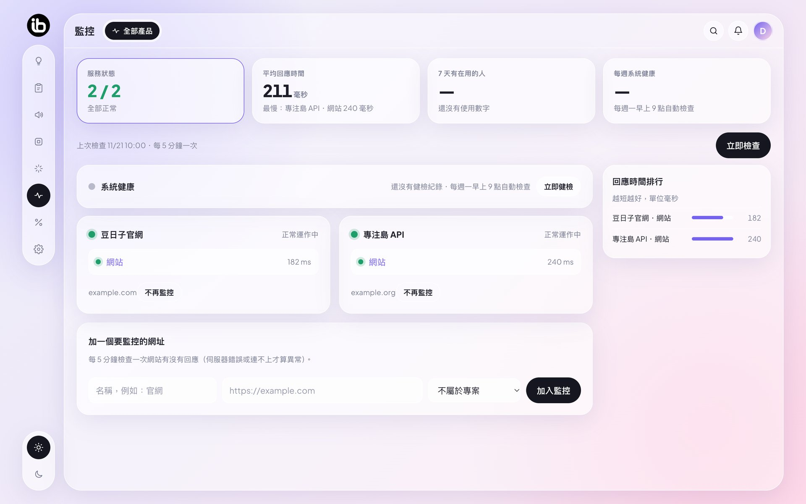
<sub>加網址就每 5 分鐘檢查，顯示回應時間與正常／異常。</sub>

- 到「監控」頁最下面「加一個要監控的網址」：填名稱、網址，可以選對應的專案。
- 每 5 分鐘檢查一次；連續失敗 2 次才算掛掉（避免網路抖一下就通知），掛掉和恢復都會傳 Telegram 與手機推送。
- 有對應專案的，專案詳細頁會顯示服務燈號。
- **系統健康**：每週一早上 9 點自動檢查排程有沒有準時跑、點子分析有沒有卡住、AI 費用有沒有暴增、Telegram 連線、網站錯誤；有問題才通知。也可以按「立即健檢」。
- 想監控更多（例如自己產品的使用者數、資料庫用量），可以寫成模組，見 README「加上你自己的功能」。

---

## 七、成本

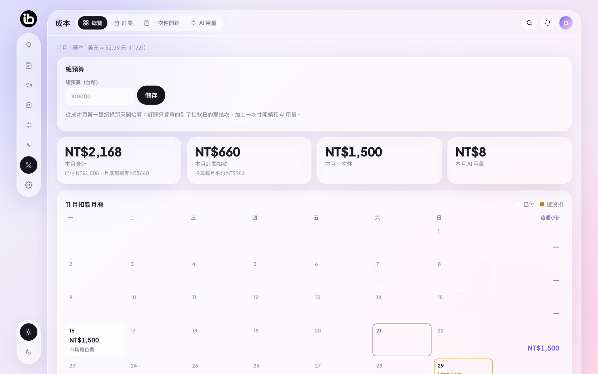
<sub>總預算、本月花費、扣款月曆，AI 用量自動記錄。</sub>

- **訂閱**：名稱、金額（台幣或美金）、月付／年付、下次扣款日、開始訂閱日（選填）、屬於哪個專案。扣款日前會提醒。
- **一次性開銷**：付款日、金額、屬於哪個專案。
- **AI 用量**：每次呼叫 Claude 都會自動記錄用途與費用，不用手動填。
- **總預算**：填一個金額，會算出已經花了多少、剩多少、平均每月、還能撐幾個月（從第一筆真的付錢那天起算）。
- 匯率每天自動更新。

---

## 八、設定

| 分頁 | 內容 |
|---|---|
| 專案描述 | 「關於你」與每個專案的描述，AI 分析點子、找補助、寫週報都會參考 |
| 連線狀態 | 登入帳號、Telegram、GitHub 權杖等是否設定好 |
| 外觀 | 語言、主題、淺色／深色 |
| 週報 | 立即傳一份週報試試看 |
| AI 學習 | AI 從你的操作學到的偏好規則；不對的可以刪掉（之後不會再學回來） |
| 手機 App | 產生配對 QR code、看已配對的手機、解除配對 |

---

## 九、手機 App

1. 照 `mobile/README.md` 把 App 裝到手機（需要 Expo 帳號；裝到 iPhone 需要 Apple 開發者帳號）。
2. 網頁「設定 → 手機 App」產生 QR code（10 分鐘內有效、只能用一次）。
3. App 掃描 QR code（或手動輸入網址與配對碼）就完成。
4. App 有：今天（排程、里程碑、專案）、月曆、專案、監控、辦公室。App 是固定的黑底外觀，換頁用左下角的選單。
5. 不用了可以在網頁上「解除配對」，那支手機就讀不到資料。

---

## 十、Slack 進度回報（選填）

適合讓各專案的 AI 助手（或你自己）在 Slack 報進度，ideabox 自動更新專案。

1. 設定 `SLACK_BOT_TOKEN`（見 README）。
2. 每個專案一個頻道，預設叫 `#progress-短名`（專案設定可以改）。私人頻道要邀請 Bot。
3. 在頻道貼這種格式的訊息：
   ```
   【完成】修好登入頁
   【下一步】做好友動態
   【階段】封測
   【日期】12/1 正式上架
   ```
4. 每 5 分鐘讀一次，AI 整理成工作日誌、下一步、階段、里程碑並直接更新；有改到東西會傳 Telegram，附「↩️ 改回來」按鈕。

---

## 十一、Telegram 指令一覽

| 指令 | 做什麼 |
|---|---|
| `/start`、`/help` | 使用說明 |
| `/top` | 本週最高分的點子 |
| `/grants` | 60 天內截止的補助 |
| `/week` | 立即產生週報 |
| `/myid` | 你的 Telegram ID |
| `專案` | 專案總覽 |
| `<短名> 下一步／下一階段／階段／記錄／里程碑／排程 …` | 更新專案（見「專案」一節） |
| `<短名> 發文 11/21 20:00 IG Reel 主題` | 排一則社群貼文並請 AI 寫草稿（見「社群助手」一節） |
| `點子 …` | 強制存進點子庫 |

---

## 常見問題

**Bot 沒反應？**
到「設定 → 連線狀態」看 Telegram Webhook 是否「已連線」；沒有就重新跑 `npm run setup:webhook`。也確認 `TELEGRAM_OWNER_ID` 填的是你自己的 ID（傳 `/myid` 給 Bot 會告訴你）。

**監控頁說「超過 20 分鐘沒有自動檢查」？**
Supabase 的排程沒在跑。確認 `schema.sql` 有完整執行，以及 `settings` 表的 `app_url` 是你的網址（結尾不要斜線）。

**點子一直「分析中」或分析失敗？**
每天晚上 9 點會自動重試；失敗 3 次會停止並列在「待補充」。通常是貼文內容讀不到，回覆 Bot 的提示訊息補一句重點即可。

**AI 費用會不會暴增？**
「成本 → AI 用量」看得到每個用途花了多少；每週健康檢查會在費用比平常高很多時提醒你。也建議在 Anthropic 後台設每月上限。
